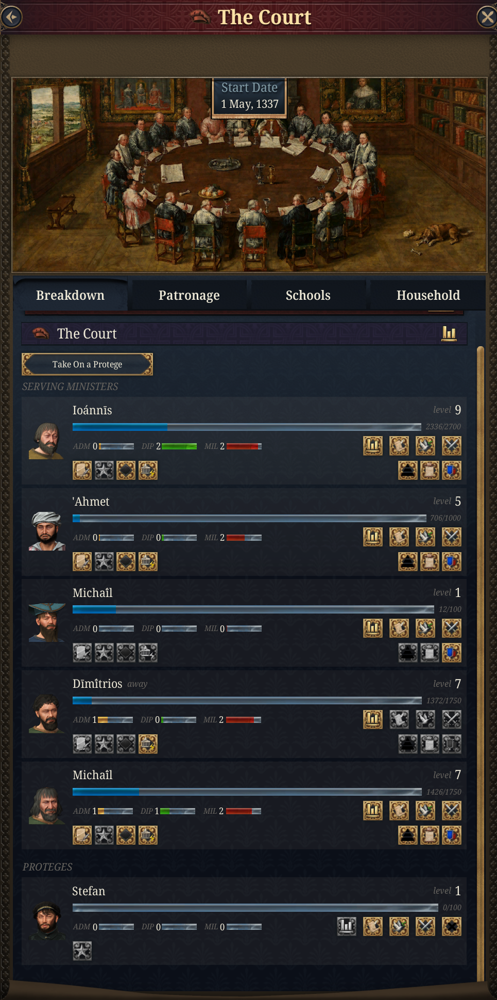
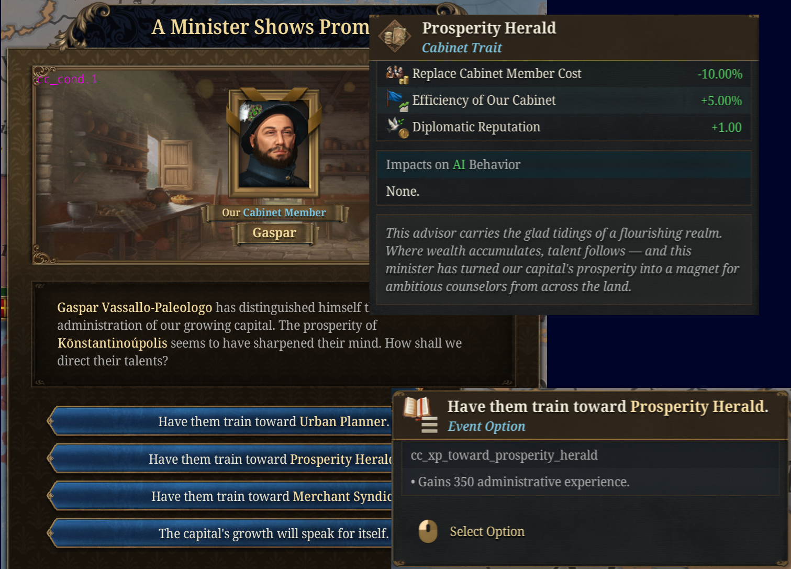
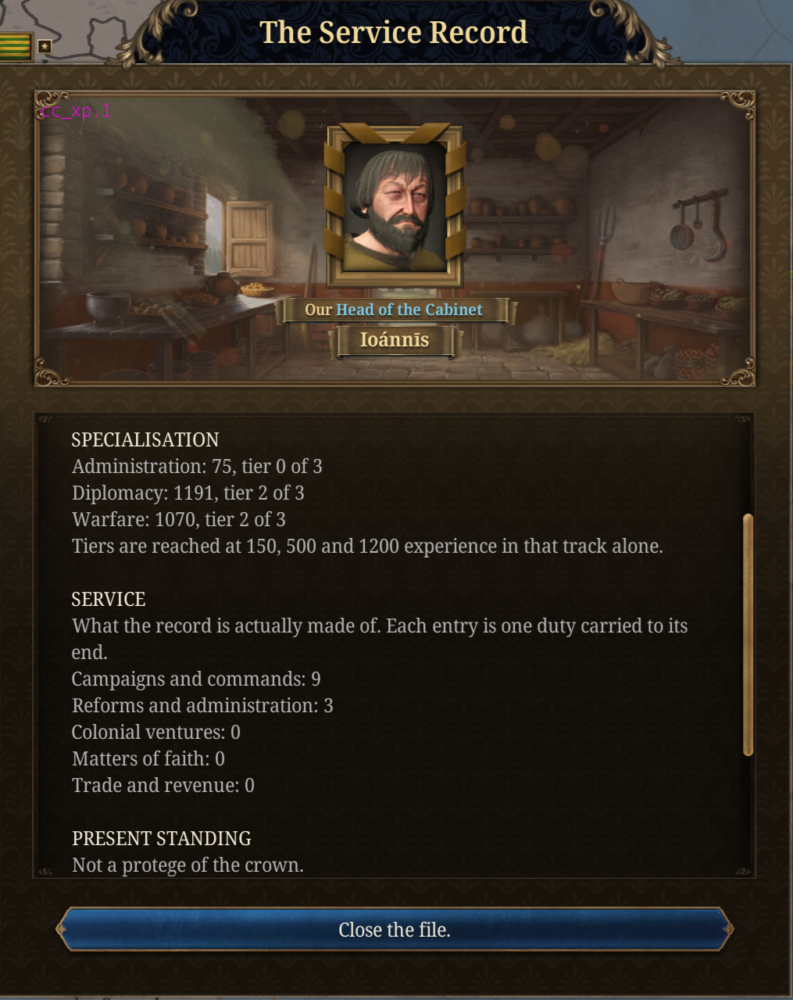
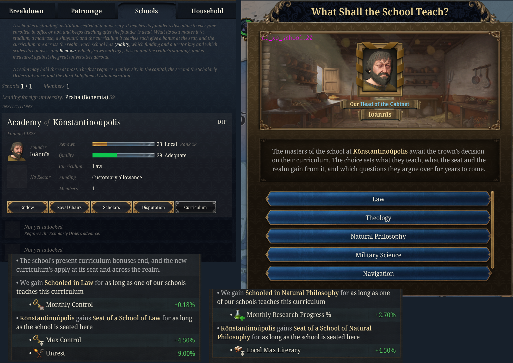
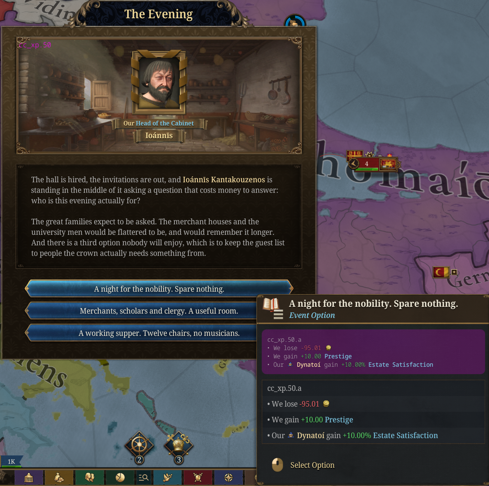
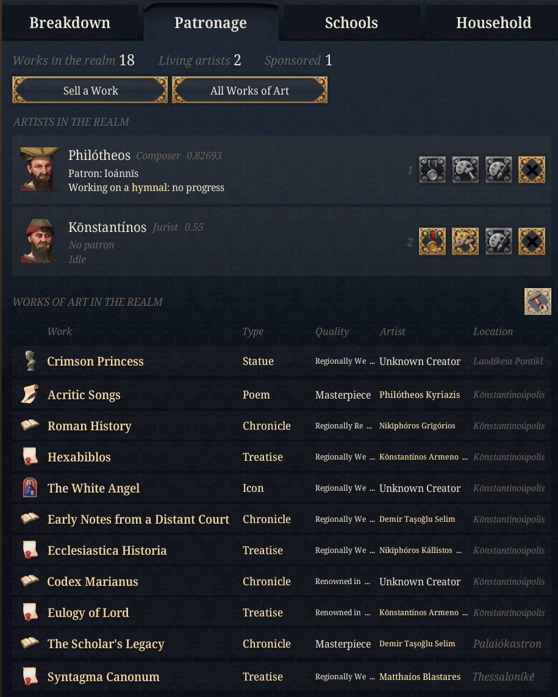

# Dev Diary: A Career at Court

*Published: 2026-08-24*

*Ministers who start bad, get better, and eventually run out of road.*

*Dev Note: the cabinet used to be a slot machine. You appointed someone, waited, and events occasionally handed them a trait. Whether that trait arrived had nothing to do with what the minister had actually spent their life doing. This update replaces that with a career: experience earned from the work, a specialisation that decides what a person can become, and a set of things you can spend money on to steer it. There is also a new Court panel to watch it happen in, and a good deal of court life hanging off the side of it.*

<figure>
  
  <figcaption>The Court panel: every minister and protege, what they have earned, and what you can do about it.</figcaption>
</figure>

---

## Two numbers, and why they are different

Every minister now earns experience in three separate tracks: administration, diplomacy and warfare. It comes from the duties you assign them, the years they serve, and the wars, laws and royal marriages the realm carries through while they are in office.

Out of that come two different things, and keeping them apart is the whole design.

Seniority

A level from 1 to 10, drawn from total experience across all three tracks. It is a measure of what someone has been through. It grants a growing bonus to how effectively they work, and it gates the things that need standing rather than skill: founding an institution, taking a pupil, presiding over an examination.

Specialisation

A tier from 0 to 3 in each track separately, drawn from that track's own experience. It is a measure of what someone has actually learned to do, and it is what decides which traits are within reach.

The two come apart constantly. A minister can be very senior and still be a tier 0 soldier, because thirty years in the treasury teaches you nothing about supply. That minister is worth listening to and worth keeping, and you still should not put them in charge of the army.

---

## Careers, not chains

Fifteen career ladders run through the trait pool. Each starts at a minor malus and ends in a mastery.

A **fumbling reformist** becomes a law reformer, then a progressive reformist, then a master reformer. A **green adjutant** becomes a tactical advisor. A **timid landlubber** becomes a capable explorer. The entry rungs are deliberately mild negatives: they are where a career starts, not a punishment.

Progress up a ladder is gated by the relevant tier, so a minister climbs only as fast as their actual experience in that discipline allows. And where a ladder forks, you are asked which way it goes.

Your treasurer has learned enough to move up, and there are two directions available. Does he learn to invest, or does he learn to audit? Your marshal has proved the offensive doctrine works. Do you give him the whole military establishment, or keep him where he has been undeniably excellent and hand him the field army? Both answers are correct. They produce different ministers.

  <figure>
    
    <figcaption>A fork in a career. Hovering either option shows the actual trait you would be choosing.</figcaption>
  </figure>
  <figure>
    
    <figcaption>The service record: seniority, progress to the next level, and the tier in each of the three tracks.</figcaption>
  </figure>

The random trait events respect all of this now. A green adjutant can no longer simply be handed a supreme command because a die came up well.

---

## Spending money on people

Four things you can pay for, all of them on the Court panel or a minister's own interactions.

Postings

Send someone to the chancery, on the embassy circuit, or to the staff college. This is a secondment, not a purchase: the minister leaves, they are unavailable while they are gone, and the experience arrives with them when they return. The embassy circuit takes about a year because it is the one that involves actually travelling.

They come back having done well, ordinarily, or badly. An accomplished minister gets more out of a posting and flounders less often, so training compounds on talent rather than levelling everyone out.

Proteges

Take up to three people outside the cabinet into the crown's care. They accumulate experience slowly on their own, but they can be trained, mentored and enrolled exactly like a serving minister, which means you can have a successor ready before a seat opens instead of appointing whoever is standing nearby. The nobility does not care for the crown noticing people it has not vouched for.

Mentorship

Put a senior minister's time at a junior's disposal for a decade. The student gains experience each year in whatever their mentor is strongest at, which makes this a way of steering a career rather than merely hurrying one. What was taught outlasts the teacher.

Court examinations

Sealed questions, answers read aloud, and a good deal of quiet reputational damage done in a single afternoon. Everyone who sits it learns something. One of them does conspicuously better than anyone expected, and it will not be the person presiding.

---

## Schools of thought

A school is a standing institution. Its founder's own discipline becomes the school's, and everyone enrolled thereafter grows in that discipline every year, in office or not. It keeps teaching after the founder is dead, which is the difference between an institution and a reputation.

A realm may hold three at most, and they are a century apart by design. The first needs a university in your capital. The second needs the Scholarly Orders advance. The third needs Enlightened Administration.

This is also what finally makes a protege worth having. Someone enrolled in a school spends the waiting years absorbing a discipline, so when a seat opens they arrive already pointed at that discipline's ladders rather than starting from nothing.

<figure>
  
  <figcaption>All three institution slots are visible from the start, each naming what unlocks it.</figcaption>
</figure>

New in 0.4, each school has a seat, a kind, a curriculum, and two numbers of its own:

<section data-tab="Seats, kinds and curricula">

A school is seated at a university, and the seat matters. Its religion decides what kind of institution the school is: a studium, an academy, a madrasa, a shuyuan, a vihara, a gurukula, a yeshiva, or simply a school. Each kind gives its own bonus at the seat. Members who share the seat's culture learn half again as fast, because they are taught in their own tongue.

Lose the seat, to conquest or a demolished university, and the school moves to another free university in the realm. If there is none, it goes into exile: the members keep studying, but the school's bonuses and projects stop until a university is free.

Each school also teaches a curriculum: Law, Theology, Natural Philosophy, Letters, Military Science, Medicine or Navigation. A curriculum gives one bonus at the seat and one across the realm, and decides which disputations the school holds. Natural Philosophy needs a school of some quality, Medicine a better one, and Navigation a seat on the coast. Changing curriculum takes ten years to settle.

</section>
<section data-tab="Quality and renown">

Two numbers describe a school, and they answer different questions.

Quality

How good the teaching is, and it is bought. Funding comes from the realm's Culture budget: the higher that slider, the better the school, and the more each one costs. A Rector, a curriculum left alone long enough, and senior ministers among the members all add to it. Quality scales everything the school gives, from half strength at the bottom to one and a half times at the top, including the experience its members earn. A good enough school also gets a fourth, better choice when it holds a disputation.

Renown

How widely the school is known, and it is earned against the world. It grows with the school's age, with how developed and literate its seat is, and with the realm's prestige and rank. Once a year every foreign university is scored on the same terms, and each of your schools is ranked against them. A renowned school raises the realm's prestige and cultural influence, and draws people: promising young scholars who can be taken on as proteges, foreign students, and artists. A school that falls well behind the leading foreign university starts losing masters and students to it. One that stands first gets its own event.

</section>
<section data-tab="Projects and the Rector">

Each school can take on one project every few years: endow its library with gold, fund royal chairs with political influence, invite foreign scholars with prestige, or hold a disputation. Disputations are short events about the curriculum, and each choice moves the school's renown or quality as well as the realm.

A minister can also be made Rector of a school, a cabinet duty chosen in the cabinet screen. The Rector's school teaches its members twice as fast, takes on projects and curriculum changes sooner, and its seat grows literacy and institutions faster.

</section>

---

## The season

You can have a minister open the season with an evening at court. Hiring the hall is the easy part. What the evening costs, and who it is for, is decided on the night.

A night for the nobility is the most expensive and buys the most goodwill from the people who already have it. A room of merchants, scholars and clergy is cheaper and buys a different kind. Or you can keep it to twelve chairs and no musicians, invite only people the crown needs something from, and get some work done.

Something always happens at these things, and what kind of something depends on how much you spent.

What can happen on the night

Two guests seated together by accident are still talking when the musicians pack up. A minister says something in a room with forty people in it, at least six of whom understood exactly what was being admitted to, and the story can be bought or allowed to run. A courtier nobody has ever looked at properly spends an hour explaining something to a minister who had not thought there was anything to explain. An estate delegation picks the one evening where refusing them would be conspicuous.

The courtier who explains something is the cheapest route into the protege system, and it is why the crown estate is worth paying attention to. Mentorship reaches those courtiers too, which opens up a pool of people the mod previously ignored entirely.

<figure>
  
  <figcaption>The evening. Each option courts a different estate and sets what sort of incident the night produces.</figcaption>
</figure>

---

## Patronage

A minister can put their name and money behind an artist for a generation. The crown gains prestige while the arrangement lasts, and the minister gains diplomatic experience, patronage being reputation work conducted at dinner tables.

The Patronage tab also lets you sell a work discreetly. Vanilla already has a diplomatic route: you name a counterparty, they can refuse, and a genuinely good piece is harder to move. This is the opposite. Nobody is named, nothing is refused, and you get noticeably less money for exactly that reason. The piece still ends up somewhere real, and the nobility notices which wall is bare.

The works list and artist status (new in 0.4)

The tab lists every work the realm holds, with its type, quality, artist and where it hangs, and a button opens the game's full Works of Art overview. An eye button hides what cannot be sold: priceless works, which are marked, and monuments, palaces, temple towers, regalia and mansions. Each artist shows who their patron is and what they are working on, with its progress. A piece at no progress is shown as stalled, which is what happens to every piece before the realm can invest in culture.

<figure>
  
  <figcaption>Works held, artists living, and what each of them is currently making.</figcaption>
</figure>

---

## The household

Besides a seat in the cabinet, a minister can hold a post in the household: seneschal, master of coin, court chaplain, and some forty others. Which posts exist depends on what the realm has researched. An advance opens a post, and a later one can close it again, so a medieval seneschal gives way to a chancery and a herald to trained diplomats. Religion, government, culture and region open posts of their own. A court can fill six at once, each costs something in court upkeep, and each post's bonus grows with the seniority of the minister who holds it.

New in 0.4:

Cards

The Household tab shows every post as a card. A filled post shows its holder, their seniority and years in the post, and its effects at the strength this holder gives them. An open post shows its base effects, what it needs, and an Appoint button that offers the most senior ministers trained for it. A filled post can be dismissed from its card.

Looking ahead

A post that an advance you can already research would close is marked as retiring. A section below lists the posts you could open with one more advance, and which advance it is.

Tenure and events

Each year in office adds a little to the post's bonus, up to ten years, on top of what seniority gives. Now and then a post raises a matter in its own line of work: the household's accounts, a sermon at court, petitions piling up, a festival, news from the frontier. A senior holder or a long-serving one opens a better way to deal with it.

---

## Sending a minister away

You can post a minister to one of your subjects as a resident. They are gone from your cabinet for years, they grow considerably while they are there, and the relationship they build moves that subject's bond every year.

Which bond moves depends on who you send. An administrator deepens the political relationship, a diplomat the personal one, a soldier the military one. Sending the wrong person is not a mistake so much as a different plan.

What you hear from them

While they are in place you hear from them. A dispatch runs to eleven pages, which is either thoroughness or loneliness, and buried in the middle is something useful. Your resident issues an instruction to a minister of a court that is not yours, in front of people, and everyone there is waiting to see whether you say so out loud. After three years of hospitality the subject finally asks for something, carefully, over dinner, in the way these things are done when refusal has to remain possible.

---

## Running out of road

Two things happen to good ministers eventually, and a third happens when they go.

Running down

A minister two decades at the top starts to run down. The work still gets done, it is simply taking longer and being checked more often, and nobody is going to say anything. You can send them to their estates for a year and manage without them, or keep them at the desk and accept what that costs.

Rivals

Two accomplished specialists of the same kind will circle each other, because there is one reputation available in that field at this court and two people qualified to hold it. It does not turn to open hostility. It turns to duplicated work, memoranda written to be read by a third party, and problems discovered in each other's proposals slightly too late to fix quietly. You can back one, let them compete, or make them sign jointly and pay for the privilege.

What they leave

When a genuinely accomplished minister dies, whoever worked beside them keeps some of it: the filing system, the contacts who now write to the office rather than the man, the way of doing things that was never written down and is followed exactly.

---

## Switching it off

All of it sits behind the **Cabinet Experience** game rule. Turned off, ministers behave as they did before and the monthly pass over each court is skipped entirely.

Experience is tracked for your own court, for great powers, and for anything grown past 100 development. Several hundred minor courts are left alone, which keeps the cost where the interesting part is.
