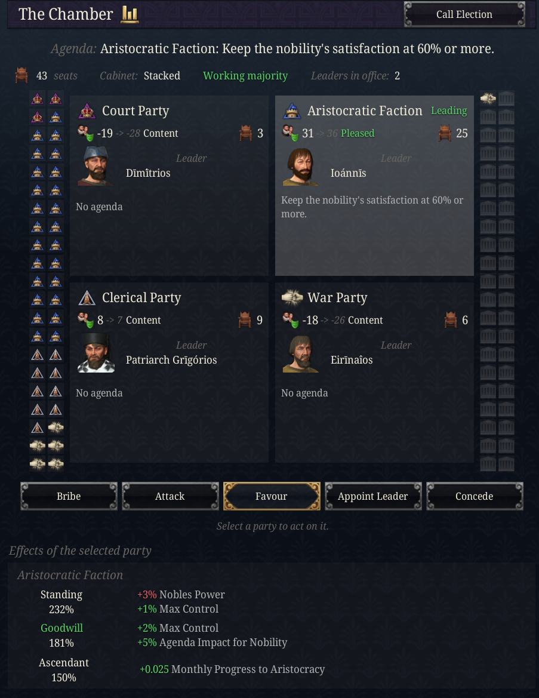
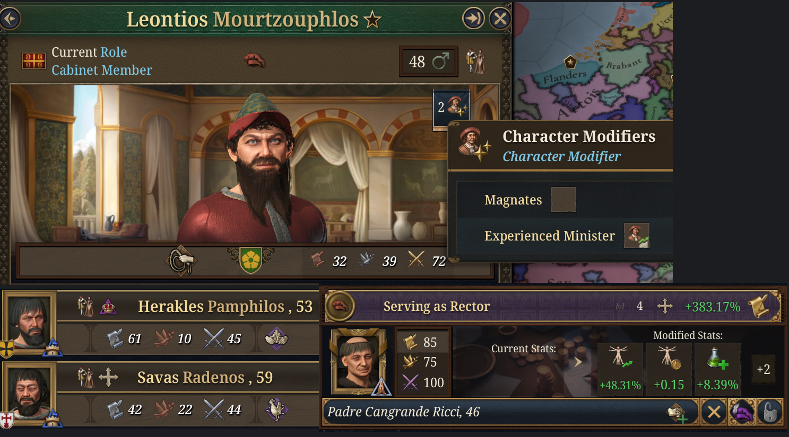
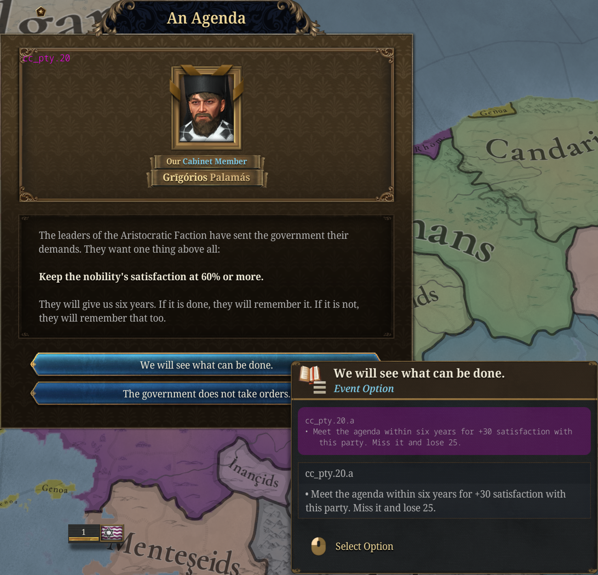
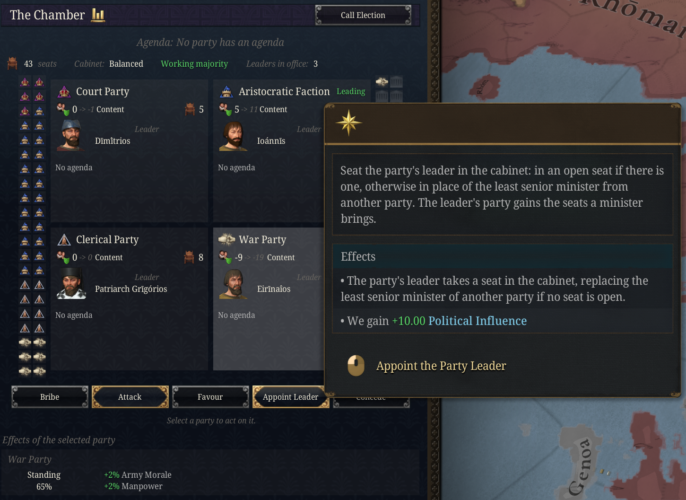
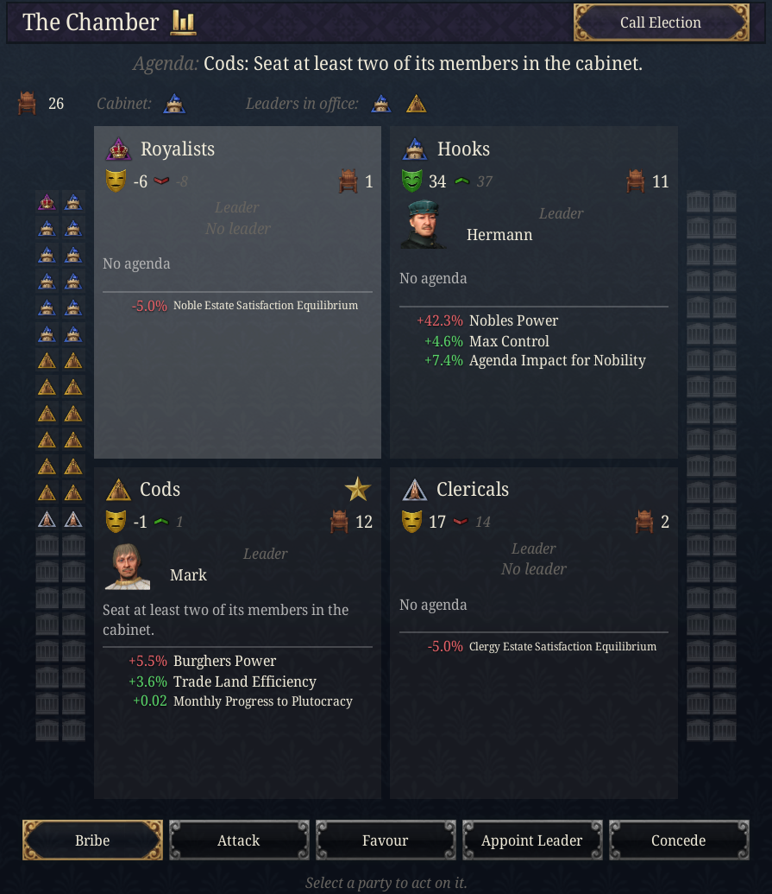

# Dev Diary: Factions

*Published: 2026-10-22*

*Four parties, the ministers who belong to them, and what they do when you ignore them.*

*Dev Note: the cabinet already had rivalries, careers and estate capture, but nothing that tied a minister to anyone outside the room. Factions gives every realm worth simulating a set of political parties. It started as a submod and is part of Flavorium Universalis from 0.4, on its own tab of the Court Ledger. They draw their strength from the estates, staff your cabinet, keep score of how they are treated, and cost political influence to manage. It is also built to stay quiet: nearly all of it runs without a popup, and the few events it does fire are budgeted.*

<figure>
  
  <figcaption>The chamber: every seat and who holds it, the four parties with their leaders, and what the leading party wants.</figcaption>
</figure>

---

## Four parties out of eleven

A realm has four parties at a time, chosen from eleven:

- **Royalists:** the crown's own people. Monarchies and hordes; in a republic they are the **Statists**, the party of the state.
- **Magnates:** the nobility.
- **Merchants:** the burghers and the trading houses.
- **Clericals:** the clergy.
- **Hawks:** the officers. Strongest in tribes, hordes and realms at war.
- **Agrarians:** the peasantry.
- **Reformers:** from the Renaissance on, for a better-run state. Not in tribes or hordes.
- **Absolutists:** from the Age of Absolutism, monarchies only.
- **Particularists:** the provinces against the capital, in realms with several subjects or thirty provinces.
- **Colonialists:** realms with colonial subjects.
- **Liberals:** only once Liberal Thought has spread far enough (see below).

Which four you get depends on your government, the age and the strength of your estates. A republic leans to the merchants and the reformers, a theocracy to the clergy, a horde to the officers and the nobility. Every fifteen to twenty-five years the line-up is reviewed. Each eligible party scores its estates' power plus those bonuses, the parties already in place get a head start, and the best four sit in the chamber. A party that survives keeps its satisfaction; a new one starts from nothing.

This is the zeitgeist part of the design. Nobody chooses to have Absolutists in 1450, and nobody stops one appearing in 1650 if the crown is strong.

---

## Everyone at court belongs to a party

Every adult at your court belongs to a party from the moment they arrive, so you know where a candidate stands before you appoint them. A cabinet trait that names a side decides it first: a royal absolutist sits with the absolutists if there are any and with the Royalists if not, and a merchant prince sits with the merchants. Failing that, the character's estate decides. Anyone left over draws evenly among the parties you have.

The party shows on the character sheet as "Member of the …", as the party's icon in every character picker, cabinet appointments included, and as a badge beside each minister's seniority on the cabinet cards. It matters because every minister brings their party **2 appointed seats** in the chamber, and because a party's mood follows its members into office. A minister whose party is pleased works 5% better. One whose party is angry works 20% worse, no matter how good they are.

<figure>
  
  <figcaption>A minister's party and their party's mood, in their modifiers.</figcaption>
</figure>

---

## The chamber

A party's strength is its seats in the chamber, and the seats come from the realm itself.

Every location is worth seats by its rank: a megalopolis 3, a city 2, a town 1, and a rural settlement a fifth of one. Each location's seats are shared among the estates by how much power each holds there, and every party takes the seats of the estates behind it. So the cities fill the merchants' benches, the countryside the nobles' and the peasants', and a realm that builds towns changes its own politics.

Those counts only set the proportions. The chamber itself grows with the realm, from 20 seats for a single province to at most 84 for an empire, so a thousand locations do not become a thousand seats. Every minister in the cabinet also brings their party 2 appointed seats, up to half the chamber; the rest are elected. A party's **power** is its share of the chamber.

Each party also has a **leader**: its most senior minister. A party with nobody in the cabinet keeps its old leader while they live, and in your realm a new one steps forward if needed. A leader outside the cabinet is someone you can appoint.

Seats matter on their own, whatever a party's mood. Every party with a tenth of the chamber or more grants its **standing**, scaled by its share: the merchants add trade efficiency and burgher power, the Royalists legitimacy and crown power, the reformers cabinet efficiency and political influence. A party below a tenth is **marginalised**, and the estate behind it settles for less. Select a party's card and the panel shows every effect the party can have as a grid of cards: standing, goodwill, discontent, its lead and its favour, plus the escalation steps for the parties that escalate. A card in full colour applies now and shows its values at their current strength; a faded card shows what it would grant at full strength. Each party card also lists, under its agenda, everything that party applies right now, added up by modifier.

The strongest party, if it holds 30% of the seats or more, leads the realm and slowly moves society its way: the merchants toward plutocracy, the clergy toward spiritualism, the reformers toward innovation, and so on.

---

## Satisfaction

**Satisfaction** runs from -100 to 100 and is reviewed every two to four years, silently. Each review it moves halfway toward what the party expects, which is:

- three **concerns** of its own, each worth up to about 15 or 20 either way
- +5 for one minister in the cabinet, +25 for two or more
- -20 if it holds a fifth of the seats or more and has no minister at all
- +15 if the head of the cabinet belongs to it, and +10 if the ruler does

The concerns are what makes each party different to manage. They read the realm directly, so most of your levers are things you already do:

| Party | Watches |
|---|---|
| Royalists | the crown's power, stability, court spending |
| Magnates | the nobility's satisfaction, its privileges, its taxes |
| Merchants | the burghers' satisfaction, their taxes, peace and loans |
| Clericals | the clergy's satisfaction, religious unity, the clergy's privileges |
| Hawks | their war record, army upkeep, the size of the army |
| Agrarians | the peasantry's satisfaction, its taxes, war exhaustion |
| Reformers | an innovative society, literacy, whether laws are being changed |
| Absolutists | an absolutist society, the crown's power, how few privileges the estates hold |
| Particularists | a decentralised society, the provincial nobility, low court spending |
| Colonialists | colonial subjects, the burghers' satisfaction, navy upkeep and peace |
| Liberals | a liberal society, term limits, taxes on the burghers |

Some of them pull against each other on purpose. The Royalists want a lavish court and the Particularists want a cheap one; the Hawks want a large, well-paid army and the Merchants want peace and no loans. A few concerns are memories rather than readings: the Hawks remember a war won or lost for ten years and grows restless after ten years of peace, the Reformers notices whether any law has changed in the last five, and the merchants do not forget a bankruptcy for twenty.

Each card shows a party's mood as a mask (green pleased, yellow content, red discontent, red with a warning triangle angry), its satisfaction, and an arrow toward what it expects: a green arrow and 33 after a 10 means it is climbing toward 33. A star marks the leading party, and a warning sign or raised fists mark a party that is escalating. Select the card and the panel breaks that expectation down row by row, with every concern's current value; hover a concern to see exactly what moves it. Parties start a game at their expectation rather than at zero, and they do not wait for a review to notice the cabinet: seating one of a party's ministers raises its satisfaction by 10 at once, and dismissing one lowers it by 10.

Above 30 a party is pleased and gives the realm a bonus. Below -20 it is discontented and gives a penalty, and below -50 it is angry. Each party has its own: an angry nobility costs you control of the countryside, angry merchants cost trade efficiency, angry Royalists cost diplomatic reputation and political influence. Both scale with the party's seats and with how strongly it feels, so a dominant angry party hurts a great deal more than a small one.

Parties tied to an estate also push that estate's parliament agendas when pleased and resist them when angry.

---

## Stacked or balanced

The cabinet itself now has a shape.

A **stacked** cabinet, where one party holds more than half the cabinet, runs well: +5% cabinet efficiency, and the party that runs it gets a stronger bonus and moves society faster. Every other party expects less, though, and the court's rivalry score climbs.

A **balanced** cabinet, where no party holds more than 40% of the cabinet and at least three are represented, is steadier. Stability is cheaper, bribes and attacks cost a quarter less, and no party's expectation falls below -20. In exchange the bonuses are weaker and society barely moves.

Two opposed parties seated together, such as the nobility and the merchants or the clergy and the reformers, also feed the court's rivalry, which ties this into the existing rivalry events rather than adding new ones.

---

## Agendas

A party with a quarter of the seats or more sets an agenda every five to twelve years. The leading party's agenda is shown above the chamber, and every card shows its own. It tells you in one event and gives you six years. Each party has three possible agendas, and it never picks one you have already met: the nobility might want its satisfaction kept above 60%, two of its people in the cabinet, or a larger share of power. The Hawks might simply want a war.

<figure>
  
  <figcaption>An agenda. You can hear them out or refuse; refusing costs 15 satisfaction straight away.</figcaption>
</figure>

Meet it and the party gains 30 satisfaction. Miss it and it loses 25. Either way the result is recorded in the panel rather than in another popup.

---

## Five actions and an election

Select a party's card and five actions act on it.

- **Bribe** (10 political influence and some gold): +25 satisfaction at once. Once every two years per party.
- **Attack** (20 political influence): prosecute its leaders and close its clubs. Its elected seats fall by 40% for five years, it loses 30 satisfaction, and every party opposed to it gains 10. Needs the party to hold at least 10% of the seats. Once every five years.
- **Ask a Favour** (no price, needs satisfaction of 10 or more): the party lends you its people for five years. The merchants improve trade, the clergy raise religious influence, the officers stiffen morale, the reformers make the cabinet work better. It costs 15 satisfaction.
- **Appoint the Leader** (earns 10 political influence: the party owes you for the seat): the party's leader takes a cabinet seat, an open one if there is one, otherwise that of the least senior minister from another party. The party gains the appointed seats that come with it.
- **Concede the Agenda** (10 government power, 10 political influence and gold): the agenda counts as met now. The party gains 30 satisfaction and every party opposed to it loses 10.

Above the chamber, **Call an Election** (10 political influence, gold and some stability) counts the seats and reviews the parties at once instead of waiting. Once every ten years.

<figure>
  
  <figcaption>Every action is priced in political influence, and the tooltip says why a button is disabled.</figcaption>
</figure>

Political influence is the currency 1.4 already uses for appointments and policies, so managing your parties competes with managing your cabinet and your laws for the same budget. The chamber also pays some of it back:

- **Cabinet shape:** a balanced cabinet brings +0.5 political influence a month; a stacked one +10% political influence gain.
- **Leaders in office:** +0.05 a month for each party whose leader sits in the cabinet.
- **Working majority:** +15% political influence gain while the head of the cabinet's party holds 40% of the seats. A **hung chamber**, where no party holds 30%, costs 10%.
- **Agenda dividend:** meeting an agenda, on time or by concession, pays political influence equal to half the party's seats.
- **Election mandate:** an election pays 2 for every seat the head of the cabinet's party gains, and costs 1 for every seat it loses.

---

## Parties you cannot ignore

Three parties have to be handled: the **Hawks**, the **Particularists** and the **Liberals**. If one of them is angry and holds a fifth of the seats or more, every review spent that way is a step toward open defiance:

1. a warning, which shows on the party's card and as a modifier
2. unrest: rebel growth and lost control
3. the outcome

The outcome depends on the party. The Hawks attempt a **coup**, which is a disaster that stays until the officers are satisfied again or five years pass. The Liberals rise in an **uprising**, which works the same way. The Particularists either raise a provincial league that takes about a fifth of your provinces into a civil war, or, if you have subjects, carry their grievance to them and they pull away. In each case you get a choice: concede, at a price, or fight it.

<figure>
  
  <figcaption>An escalating party. Two steps of warning come before anything lands.</figcaption>
</figure>

There are two ways out before that. Placate the party until it is no longer angry, or attack it until it holds less than a fifth of the seats. Both step the escalation back down. Doing neither is a choice too.

---

## Liberal Thought

From the Age of Absolutism, liberal ideas start to spread in your capital and your cities. Each city has its own level, which grows with literacy, the presence of the court, the Enlightenment and a liberal-leaning society, and falls while the Absolutists lead the realm. The Court Ledger's map mode shades your cities by how far it has taken hold.

<figure>
  
  <figcaption>Liberal Thought by city. The panel shows the average.</figcaption>
</figure>

When the average passes 50, the Liberals form and the next review brings them into the line-up. They want a liberal society and term limits, and they are one of the three parties that will not stay quiet if ignored.

While the Reformers or the Liberals lead the realm, **term limits** apply: a minister who has served ten years steps down at the next review and cannot return for ten. Long-serving favourites become a liability to whoever relies on them.

---

## Names

Each party has a plain name, and some realms get the names their parties actually had:

- the Hooks and the Cods in Holland
- Guelphs and Ghibellines in early Italy
- Hats and Caps in Sweden from the Age of Absolutism
- Tories and Whigs, and the Country Party, in Britain; Radicals from the Age of Revolutions
- Boyars among the Russians and Romanians, Grandees in Iberia, Clan Elders and a Warband in tribes and hordes
- Ulema, Brahmins or Sangha in place of the Clericals, by faith, and Ultramontanes among Catholics from the Reformation
- Statists, Oligarchs and Federalists in republics, Loyalists in hordes, Constitutionalists in monarchies
- Company Men among the Dutch and British, the Indies Interest in Iberia
- Ultras and, in a republic, Jacobins in France from the Age of Revolutions
- Humanists before the Reformation, where the Reformers will later be

<figure>
  
  <figcaption>Holland, where the nobility and the towns had names for each other long before this mod.</figcaption>
</figure>

---

## Keeping it quiet

Every one of these little systems is tempting to announce, and a game full of them becomes a game of closing popups. So:

- satisfaction, agenda results and the first two escalation steps appear only in the panel
- new agendas, new parties and the Liberals' arrival share one budget of about two events a decade
- the only character event, a minister crossing the floor, fires only for ministers currently in the cabinet and shares the cooldown of the existing rivalry events
- the outcomes of escalation always fire, because by then you have had two warnings

Parties are simulated for you, for the great powers and for any realm with 100 or more development. Smaller AI realms have none, which keeps the cost down and keeps the system aimed at the realms that matter. The game rule "C&C: Political Parties" (on by default) turns it off entirely. Like every game rule it is set when the game starts. It is independent of the cabinet experience rule: with experience off and parties on, the Court Ledger shows only its Factions tab.

---

## Status

This is the first version, and it has not yet been played through. The numbers above are first guesses, and the Liberal Thought rate in particular will need tuning once it has been seen across a full game. With parties on, the mod's estate-capture events, court-captured modifiers and balanced-court bonus give way to the party versions for the realms that have parties.
